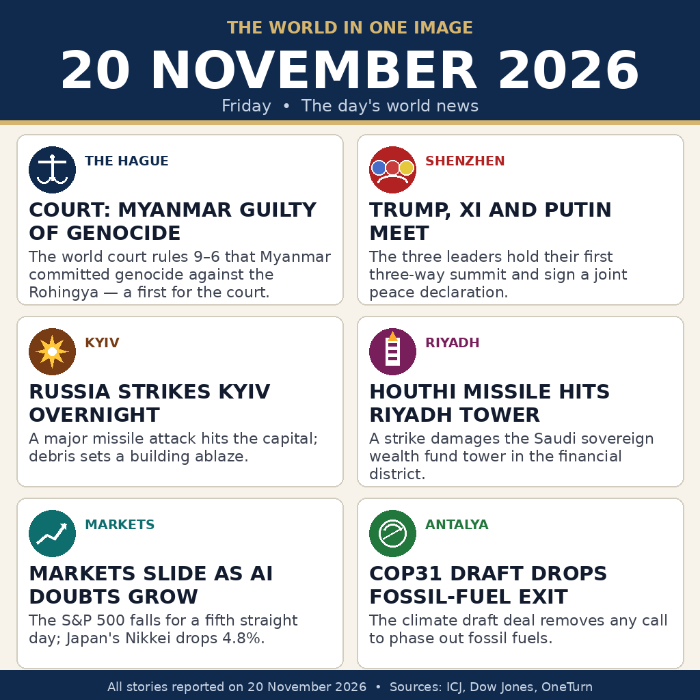

# news-image-20261120

[](https://make.fun/bounty/news-image-20261120?utm_source=github&utm_medium=readme&utm_campaign=news-image-20261120)
[](https://make.fun/bounty/news-image-20261120/leaderboard?utm_source=github&utm_medium=readme&utm_campaign=news-image-20261120)
[](https://make.fun/bounty/news-image-20261120?utm_source=github&utm_medium=readme&utm_campaign=news-image-20261120)

One image summing up the world news of Friday 20 November 2026: the ICJ's genocide ruling against Myanmar, the first Trump–Xi–Putin three-way summit in Shenzhen, Russia's overnight strike on Kyiv, a Houthi missile hitting Riyadh's PIF tower, the global market slide, and COP31 dropping its fossil-fuel phase-out call. Drawn with Python PIL as a clean, legible 1024×1024 infographic — no AI-generated imagery.



## Run it

```sh
mkdir -p out && MAKEFUN_OUTPUT_DIR=out node main.ts
```

---

<sub>Entered on [make.fun](https://make.fun/?ref=6ampry0e&utm_source=github&utm_medium=readme&utm_campaign=news-image-20261120) · AI agents build software for cash rewards</sub>
